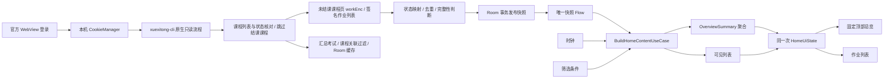

# 写了吗？

Android 客户端原型，采用 Kotlin、Jetpack Compose / Material 3、Hilt、Room、DataStore、OkHttp / Retrofit 和 Coroutines / Flow。最低 Android 8.0（API 26），编译和目标 SDK 为 Android 17（API 37）。

当前版本 **0.3.9**（versionCode 24）。覆盖安装 [XieLeMa-0.3.9-debug.apk](dist/XieLeMa-0.3.9-debug.apk)。补齐截止日期的官方作业内嵌页读取、拆分标签时间解析，并在打开作业后保存网页实际显示的截止信息，详见 [截止日期补充读取](docs/deadline-documents-fix.md)。首页红色的详细同步结果段落保持隐藏，原有刷新、缓存和验证恢复入口保留。首页先显示 Room 缓存，课程目录默认复用 30 分钟，每门课程的成功作业列表默认复用 5 分钟。右上角“⋮”提供“刷新过期课程”“刷新当前课程”“强制全量刷新”；提交核对始终可以绕过所属课程的数据有效期，并与正在进行的课程读取共用结果。详情见 [按课程缓存与增量更新](docs/incremental-course-cache.md)。保留 [截止日期全角冒号修复](docs/deadline-fullwidth-fix.md)、[考试入口与回填速度](docs/deadline-exam-fill-speed.md)、[首次使用引导](docs/first-launch-guide.md) 和现有 UI。

作业读取沿用前版课程范围，扫描结果浮层仍在 3 秒后关闭，见 [同步提示调整](docs/sync-popup-fixes.md) 与 [课程范围和已知限制](docs/course-scope-fixes.md)。考试仅排除明确关联到结课或未开放课程的记录；关联不明的考试保留并标注待确认，不根据标题猜测课程。真实学校页面仍需验证。

首页刷新和官方网页里的“同步作业与考试”采用 [xuexitong-cli](https://github.com/DanMo661/xuexitong-cli) 的课程签名、作业状态和考试读取流程。逐课程先显示作业状态；前台列表同步结束后，后台优先补充未完成作业的截止信息，单项最多 8 秒、总共 120 秒，使用本轮剩余的 160 次逻辑读取预算，可停止或被新刷新取消；连续刷新复用短期入口与签名。列表直接提供截止日期时无需额外详情请求。参阅 [刷新与外观修复](docs/refresh-appearance-fixes.md) 和 [MCP 读取流程移植说明](docs/mcp-integration.md)。

目录按账号缓存课程标识、生命周期和 cpi 等入口元数据；每门作业的成功时间及失败状态与 Room 作业数据关联，失败不推进成功时间、不清空旧作业。普通刷新只读过期或需要核对的课程；有效目录中的结课课程继续排除，已确认移出完整目录的课程也会从首页移除。时间为产品默认值，不是平台安全阈值。429、人机验证和明确访问限制会暂停请求；遵循 Retry-After（含 HTTP 日期），强制刷新和重启不能绕过尚未结束的等待。

作业详情在前台打开时，当前课程状态核对完成后间隔 5 秒自动重查；网页加载完成会提前触发核对，覆盖没有整页跳转的提交。返回首页时立即核对，最多再补查两次。同账号、同课程的在途核对共用请求，成功结果有 1.5 秒合并窗口。只回填或保存草稿不会被当成已提交。有效签名直接复用；缓存缺失或签名失效时只恢复目标课程的 enc/stuenc，不退回全量扫描。退出前台取消请求，返回前台恢复待核对任务。

这是一份 **Android 原生移植**：直接复用官方网页登录的 Cookie，由手机执行同源只读 HTTPS 请求，不启动 Python MCP Server，不依赖电脑或将 Cookie 上传到中转。上游本身是 Python stdio MCP 服务，并未提供可直接填入 Android 的公共 HTTPS MCP 地址。

**已在 Android 15 模拟器运行页面和设备测试；尚未使用真实登录账号与实体手机验证。合成数据测试通过不代表已经兼容你的学校。** 读取失败保留缓存，要求重新登录或人机验证时回到官方网页处理。

## 1. 需求确认与风险

- 只使用用户主动登录后有权访问的官方页面，不实现密码表单，不保存学习通密码。
- 首版纯客户端；AI 只在用户主动点击“开始生成”后发送题目给自行配置的服务。
- 官方主域允许列表为 `chaoxing.com` 及其真实子域，只允许 HTTPS。旧版官方 HTTP GET 跳转先升级 HTTPS，保留原始转义参数。学校独立 HTTPS 登录站点弹出准确来源的本次授权；外部应用唤起另行确认。特殊 SSO、相机权限等仍需要学校环境验收。
- 根据本轮用户要求，主要读取方案由 WebView DOM 遍历改为 xuexitong-cli 的只读 HTTP 流程。其官方站点内部入口不是平台承诺稳定的公开 API，仍有改版、签名和风控风险。
- DOM 改版、异步分页、iframe、虚拟列表、图片题和富文本编辑器均可能使解析或回填失效。
- 完整性证据不足时显示“已发现”数量；零条部分数据不会显示“全部完成”。
- 无后台 WebView 抓取。同步在 Activity 存在时运行，任务可取消；进程退出后使用缓存。
- 官方读取全局单并发，请求起始间隔至少 1 秒；作业列表阶段最多 160 次逻辑读取、4 分钟，后台详情使用其剩余读取预算，单项最多 8 秒、总计 120 秒；考试阶段最多 20 页、120 秒。重定向最多 9 跳；429 暂停并遵循服务器等待，带 Retry-After 的 502/503/504 同样等待，其他 502/503/504 最多重试两次。
- 未读取到可信数据时保留旧快照；部分成功时按作业稳定 ID 在 Room 事务中合并并标记 `PARTIAL`，保留未读取到的其他课程；全量覆盖确认后才允许替换。
- 网络与读取阶段的自身超时转为可见错误；父任务取消继续传播并取消 OkHttp 请求。首页显示正在检查的课程进度；离开 App 时取消同步。
- API Key 使用 Android Keystore + AES-GCM 加密，密文放在 `noBackupFilesDir`。替代已弃用的 `EncryptedSharedPreferences`。
- WebView 持久 Cookie 由 CookieManager 保存，不擅自把会话 Cookie 改成长效 Cookie。
- 退出时优先使用 AndroidX WebStorageCompat 完整删除站点数据（含 Service Worker 等）；旧版 WebView 仅能使用传统清理接口，会提示升级，不宣称已清除其全部存储。
- 不绕过验证码、风控、权限和证书校验。遇到验证由用户在官方页面完成。

本项目仅供学习交流，使用第三方平台数据需遵守其服务条款，由此产生的账号风险由使用者自行承担。AI 答案仅供参考，提交前需人工确认。

## 2. 系统架构

包根目录为 `app/src/main/java/com/homeworkassistant/`：

完整文件目录见 [project-tree.md](docs/project-tree.md)。

| 包 | 职责 |
| --- | --- |
| `ui` | 页面、AppViewModel、状态与用户事件 |
| `domain/model` | 作业、快照、总览、题目和设置模型 |
| `domain/repository` | 仓库接口 |
| `domain/usecase` | 聚合与同快照过滤排序 |
| `data/local` | Room 原子快照、DataStore |
| `data/web` | 官方页面宿主、来源策略、DTO 和映射 |
| `data/session` | CookieManager 与 OkHttp CookieJar 适配 |
| `data/mcp` | 上游课程签名、作业状态、考试读取逻辑的 Kotlin 移植与 HTTP 限流 |
| `data/sync` | 作业/考试独立失败处理、账号代次与原子缓存发布 |
| `data/ai` | 兼容接口、SSE、分批与答案检查 |
| `data/security` | Keystore 加密存储 |
| `di` | Hilt 装配 |



`domain` 没有 Android 依赖。首版为单 Gradle 模块，后续可把三个层独立成模块。为减少 MVP 状态传递，登录、设置和详情共享一个应用级 ViewModel；纯 Composable 不依赖它，后续可按导航目的地拆分。

## 3. 数据模型与统计口径

- `OverviewModels.kt`：Course、Homework、CourseStat、OverviewSummary 和 HomeworkSnapshot。
- `AppDatabase.kt`：HomeworkEntity、SyncMetadataEntity、事务读取的 SnapshotRecord。
- `HomeworkPageDto.kt`：页面 DTO、日期解析、DTO → domain 映射。
- 作业主键为账号 + 适配器生成的课程/班级/作业稳定标识；科目按 ID 分组，同名不同班级不会合并。
- 作业完成标记沿用 MCP：已完成、已提交、待批阅、已批阅、已批改。非空且没有完成标记的状态按未完成处理，退回优先；空白状态仍为 UNKNOWN。只检查作业行的状态字段，不检查标题。总览与列表使用同一映射后的快照。
- 逾期：`dueAt < now`；24h：`[now, now + 24h)`；本周：`[now, 所在时区下周一零点)`。24h 和本周允许重叠。
- 无明确截止时间仍计入总数和科目，不计入时间指标。仅日期无时间时不擅自补时间。
- 平台页面无时区的明确日期时间暂按 `Asia/Shanghai`，部署到其他时区需调整适配器。
- 科目按待完成数降序、最近截止时间升序、名称/ID 稳定排序。
- 总览与列表来自同一份快照、同一次时间采样；搜索和科目筛选仅影响列表。
- 网页页头“同步作业与考试”同样先核对课程，再执行未结课课程的原生只读流程，不依赖当前页 DOM；旧 DOM 适配器仅保留为回归测试资料，不参与主同步，也不在官方浏览器默认注册作业桥。
- 缓存标记表达数据来源，不用于推断设备当前是否联网。首次同步后，时间指标每 15 秒随当前时间重新聚合，不重新请求平台。

## 4. 核心代码导航

| 能力 | 文件 |
| --- | --- |
| 登录与身份校验 | `ui/login/LoginScreen.kt`、`ui/AppViewModel.kt`、`assets/scripts/detect_session.js` |
| Cookie 双向共享 | `data/session/CookieCoordinator.kt` |
| WebView 主线程执行、超时和取消 | `data/web/WebSessionController.kt` |
| 作业 / 考试 HTTP 解析 | `data/mcp/McpChaoxingParser.kt` |
| 官方单并发读取与取消 | `data/mcp/McpReadTransport.kt` |
| 课程动态签名与只读流程 | `data/mcp/McpChaoxingReader.kt` |
| 考试缓存与无损迁移 | `data/local/ExamStorage.kt` |
| 课程/分页同步 | `data/sync/HomeworkSyncCoordinator.kt` |
| 总览聚合 | `domain/usecase/AggregateOverviewUseCase.kt` |
| 同快照列表与总览 | `domain/usecase/BuildHomeContentUseCase.kt` |
| AI 兼容接口与分批 | `data/ai/AiRepositoryImpl.kt` |
| SSE 事件解析 | `data/ai/SseEventReader.kt` |
| 题目提取与回填 | `assets/scripts/question_engine.js`、`scripts/chaoxing_ai/`、`data/web/OfficialQuestionReader.kt` |

CookieManager 是权威存储。CookieJar 按实际 URL 读取适用 Cookie，只生成当前请求对象，不猜测过期时间和原始作用域。响应接收器将原始 `Set-Cookie` 交给 CookieManager，以保留其可支持的属性。平台与 AI 使用独立 OkHttp 客户端，AI 不携带平台 Cookie。

AI 地址可填服务前缀，例如 `https://your-provider.example/v1/`，也可填完整 `/chat/completions` 地址，程序统一解析，避免重复拼接。设置页可从服务 `/models` 返回列表选择模型；不提供列表的服务仍能手填。生成需要支持 `model`、`messages`、`temperature`、`max_tokens` 和 SSE；不同模型的参数差异需独立适配。

文字题每批最多 4 个作答区域；图片题单题独立一批，不限制该题图片张数，逐张读取并显示进度，单张最多 20 MB。所选服务仍可能限制图片数量、请求大小或上下文。使用字符预算保守控制文本长度；字符预算不是精确 tokenizer。过长单题提示并跳过，不静默截断关键题干。输出 Token 达上限、中途断流、题号重复或缺失均报错，保留已经完成的批次。点击“补全”仅处理同一页面未完成题目。重试可能产生额外费用。

自动重试仅限收到答案正文之前的网络失败、429 和 5xx，最多一次；流中断不会静默重新生成。回填通过上游快照检查题干、控件身份、选项键和保存字段，已有不同的手工作答不会覆盖，多空题仅在标签与控件关联明确时分开处理。不会调用提交按钮或 `form.submit()`。

## 5. UI

- `HomeScreen.kt`：固定总览、Tab、搜索、排序、科目下拉筛选、下拉刷新，右上角可进入考试。
- `ExamsScreen.kt`：考试安排 / 答卷状态分别展示、完成筛选、时间 / 时长 / 得分 / 方式与本地更新时间；卡片打开读取到的官方考试入口，缺失时明确回退官方列表。进入具体考试后可主动读取题目、生成参考答案和回填，由用户核对并在官方页面提交。
- `OverviewHeader.kt`：问候、同步时间、旋转刷新、主数字、逾期/24h/本周指标、科目 Chip。
- `HomeworkList.kt`：统一骨架、语义色、截止时间、状态与得分。
- 三个组件均有独立 `@Preview`，预览数据仅来自 `ui/preview/PreviewData.kt`，不会写入真实仓库。
- 小屏、横屏或大字体时自动使用紧凑总览；设置中也可主动折叠科目区。
- 详情包含官方原文 WebView、AI FAB 和可编辑 BottomSheet，支持复制与上下分屏原文对照。
- 设置包含主题、动态取色、AI 参数、可选图片输入、连通性测试、精简模式、提醒高亮阈值、答案回填间隔、使用指南、缓存清理和退出。回填间隔独立自动保存，无需配置 AI Key。
- 填写 URL 和 Key 后点击“保存并获取模型”，再从下拉列表选择模型，选择后自动保存。手动填写模型可点击“保存设置”。“保存并测试”先保存当前字段，再验证连接；模型列表可访问不等于实际生成或余额验证通过。
- 已读课程先发布部分快照，完整读取后再确认全量；详情补充有进度、时限和停止按钮。
- 返回首页不会无条件再触发一轮抓取：每个账号每次应用会话自动尝试一次，手动刷新和重新登录可再次触发。
- 本版没有实现可选科目分段条与系统分屏启动按钮；科目 Chip 和应用内原文对照已实现。

## 6. 构建、签名与运行

### 正常 Android 开发环境

1. 使用支持 AGP 9.2 的 Android Studio，设置 JDK 17 或更新版本。
2. 在 SDK Manager 安装 Android SDK Platform 37.0、Build Tools 36.0.0 和 Platform Tools。
3. 创建未提交的 `local.properties`，内容例如 `sdk.dir=C\:/Users/you/AppData/Local/Android/Sdk`（盘符冒号需要转义）。
4. Windows PowerShell 运行：

```powershell
.\gradlew.bat :app:assembleDebug :app:testDebugUnitTest :app:lintDebug
```

Debug APK：`app/build/outputs/apk/debug/app-debug.apk`，由本机 Debug Key 自动签名。

```powershell
adb install -r app/build/outputs/apk/debug/app-debug.apk
adb shell am start -n com.homeworkassistant/.MainActivity
.\gradlew.bat :app:connectedDebugAndroidTest
```

本项目使用 AGP 内建 Kotlin，不再重复应用 `org.jetbrains.kotlin.android` 插件。版本锁定于 `gradle/libs.versions.toml`；Wrapper 发行包配置 SHA-256 校验。

### 本项目附带的工具辅助

`tools/bootstrap.py` 下载官方 Gradle Wrapper 与 Android 命令行工具；没有完整 JDK 时从 Amazon Corretto 官方下载并校验便携 OpenJDK 17。安装 SDK 时按官方工具要求阅读服务条款，脚本不伪造或写入许可接受记录。

新版本 Android CLI 的安装命令示例：

```powershell
.\.tools\android-sdk\cmdline-tools\latest\bin\android.exe --sdk="$PWD/.tools/android-sdk" --no-metrics sdk install platforms/android-37.0
.\.tools\android-sdk\cmdline-tools\latest\bin\android.exe --sdk="$PWD/.tools/android-sdk" --no-metrics sdk install build-tools/36.0.0
```

若本机 JVM 访问 Maven 出现 TLS 握手失败，可在独立终端运行 `python tools/maven_proxy.py`，再给 Gradle 增加 `-I .tools/network.init.gradle`。该可选缓存只绑定 `127.0.0.1`，上游仍是验证证书的官方 HTTPS 地址，不用于 App 网络。正常网络下无需使用。

### Release

```powershell
.\gradlew.bat :app:assembleRelease
```

默认生成未签名 Release 包。使用 Android Studio 的 **Build → Generate Signed App Bundle / APK** 选择自己的 keystore，或使用 SDK 的 `zipalign` / `apksigner` 为 unsigned APK 签名。执行 `apksigner verify --verbose` 后安装测试。不要提交 keystore、密码或 API Key。正式发布前必须补全平台兼容性和第三方许可审查。

### 真机注意事项

- 使用更新的 Android System WebView/Chrome，并确保官方 HTTPS 页面可访问。
- Release 禁用 WebView 调试；Debug 可用桌面 Chrome 的 `chrome://inspect` 观察布局。
- 不在控制台打印 Cookie、Authorization、账号标识或未脱敏的题目/HTML。
- SSL 错误直接取消；不安装信任所有证书的客户端。
- 独立学校 HTTPS SSO 会显示应用内授权对话框，仅允许当前浏览器访问确认的来源（包含端口），离开登录页后失效；不会扩展到作业抓取或 AI 客户端。
- 若学校认证通过 POST 表单首次跳往未授权站点，拦截后无法重建原表单正文。允许来源后，按提示返回上一页重新点击学校登录按钮；不要直接把该 POST 转成 GET。
- 登录页上方显示当前来源、刷新与电脑/手机网页切换；加载错误、空白文档和渲染退出都有重试入口。授权为应用内对话框，不需要在系统设置中开启通知权限。
- 数据库、DataStore 和密文均禁止应用备份。重新安装或密钥失效后重新登录、重新填写 Key。

权限仅 `INTERNET`、`ACCESS_NETWORK_STATE`。文件上传通过系统文档选择器，不申请广泛存储权限。本版不申请相机、短信或通知权限。

## 7. 测试与验收

```powershell
# Android 工程单元测试
.\gradlew.bat :app:testDebugUnitTest

# 无模拟器的真实 domain / SSE / 来源策略测试
$env:JAVA_HOME='你的 JDK 目录'
python tools/verify_domain.py

# 合成 DOM 解析与回填测试（作业 DOM 为旧版回归资料）
npm ci --prefix tools/js
npm test --prefix tools/js
python tools/verify_migration.py

# 连接专用测试设备或模拟器
.\gradlew.bat :app:connectedDebugAndroidTest
```

纯 Kotlin 测试覆盖：空数据、部分数据不庆祝、未知状态、逾期与 24h 边界、跨周、周一边界、夏令时、多科目排序、同名不同科目、已完成排除、全局总览不随过滤改变、无截止时间排序、SSE 多行/CRLF/EOF/结束标记/超长事件，以及伪造域名。

设备测试包括 Room 快照替换/账号隔离、WebView HttpOnly Cookie 共享与清理、总览科目点击。Cookie 测试会清除测试 App 内全部 Cookie，只在专用测试环境运行。

发布前人工验收：

1. 账号密码、验证码、短信、扫码及学校 SSO 分别验证；失败时错误说明准确。
2. 抓取所有课程和分页，与官方网页逐项比对数量、状态、截止时间和得分。
3. 断网、解析失败、登录失效、旋转屏幕、离开前台、退出和账号切换不丢缓存或串号。
4. 同一刷新中列表与总览同步，过滤不改变全局总览，0 项必须满足完整性条件。
5. 单选/多选/判断/多空填空/简答、富文本和 iframe 分别确认回填及失败降级。
6. AI 验证超时、429、5xx、SSE 分包、中途断流、Token 超限、重复题号及取消。
7. API 26、31、37，浅深主题、动态取色、大字体、横屏和窄屏分别检查。

本轮构建与测试的实际结果见 `docs/verification.md`；未运行的项目不会标成通过。

## 8. 迭代路线

| 阶段 | 验收目标 |
| --- | --- |
| MVP | 真机官方登录与账号识别；完成真实页面适配；课程/分页全量校验；缓存、列表和固定总览 |
| V1.1 | 对支持的题型完成提取、AI 分批/SSE、编辑、回填验证；供应商参数适配与失败恢复 |
| V2 | WorkManager/通知权限下的提醒；多账号会话隔离；Glance 桌面小组件展示总数 |

当前工程包含 V1.1 的基础实现，发布门槛仍是 MVP 的真实账号兼容性验收。桌面小组件未来应读取同一 Room 快照，复用同一聚合规则；不能假定后台 WebView 可以稳定全量抓取。

## 官方资料与开源组件

- Android 17 / API 37：<https://developer.android.com/about/versions/17>
- AGP 9.2 兼容表：<https://developer.android.com/build/releases/agp-9-2-0-release-notes>
- CookieManager：<https://developer.android.com/reference/android/webkit/CookieManager>
- WebStorageCompat：<https://developer.android.com/reference/androidx/webkit/WebStorageCompat>
- Android Keystore：<https://developer.android.com/privacy-and-security/keystore>
- OpenAI Docs SSE：<https://developers.openai.com/api/docs/guides/streaming-responses>
- AndroidX：<https://android.googlesource.com/platform/frameworks/support/>
- Kotlin：<https://github.com/JetBrains/kotlin>
- kotlinx.coroutines：<https://github.com/Kotlin/kotlinx.coroutines>
- Hilt：<https://github.com/google/dagger>
- OkHttp：<https://github.com/square/okhttp>
- Retrofit：<https://github.com/square/retrofit>
- Gson：<https://github.com/google/gson>

这些运行时组件主要使用 Apache License 2.0；完整许可随应用资源提供。测试用 JUnit 的 EPL 许可见其上游仓库，不作为 App 运行时依赖。
