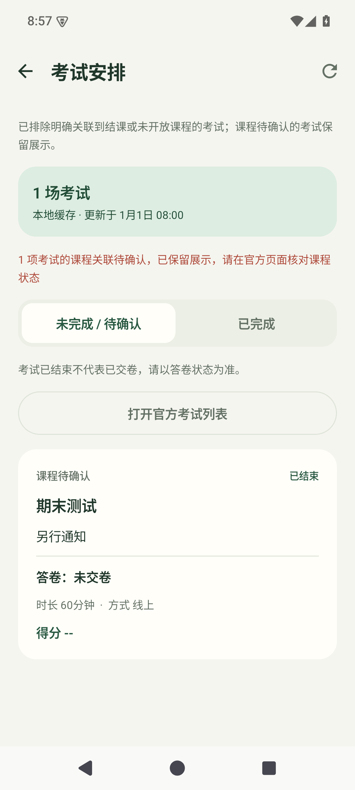
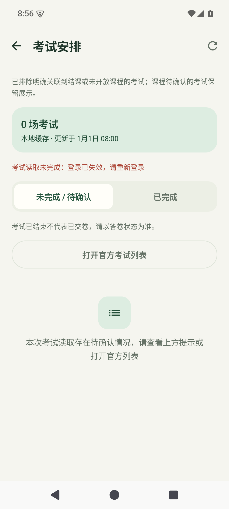

# 图片与考试读取修复（0.3.1）

日期：2026-10-29。版本：0.3.1 / versionCode 16。

## 多图片

旧实现直接跳过超过 4 张图片的题，且全题图片共享 40 秒预算、单张限制 2 MB、拒绝所有跳转。现在图片题独立成批，完整读取全部图片，不设置张数限制；逐张显示进度，单张最多 20 MB、90 秒。支持官方域名内跳转、暂时性网络/HTTP 错误重试、原页面 Referer 与官方 User-Agent，按文件头识别格式，避免有效图片因错误 MIME 被拒绝。

任何一张失败时明确报告题号与图片位置，整题不发送缺图请求，其他题继续；可以点击“补全”重试。图片字节直接发往自行配置的 AI 服务，源地址、平台 Cookie 与 Referer 不进入 AI 请求，图片不落盘。所选模型仍需支持图像输入，其请求大小、图片数量和上下文限制由服务决定；并非承诺无限内存或无限服务配额。

## 考试列表

复现了两个代码问题：考试缺少课程/班级信息时被全部过滤；解析固定依赖 `tr.dataTr` 和列顺序。现在保留无法关联的考试并标注“课程待确认”，只排除明确关联到已结课或未开放课程的记录。不根据考试标题猜测课程。兼容包含考试名称、考试时间表头的表格及列重排，保留旧格式兼容。

读取失败保留待确认考试缓存和原更新时间，考试页显示专属错误，即使已有空快照也不再只显示“暂无考试”。考试阶段总预算调整为 120 秒，页数上限仍为 20。未识别的页面继续报错并保留缓存；课程目录未取得或课程状态全未知时仍需先重新核对课程，所有课程均明确结束/未开放时不追加考试请求。

考试安排与答卷状态分开，已结束不等于已交卷；本次修复列表读取与展示，仍通过官方页面查看考试。

## 其他修复

- 设置中的字符预算和输出 Token 可以清空重输，非法范围不能保存，避免保存旧值或静默改值。
- 回填执行期间禁用答案编辑和分屏切换，并在 ViewModel 拦截编辑，避免回填反馈对应不上当前答案。
- 回填错误移出答案滚动列表，查看后面的题时也能看到错误。

## 验证

- 158 项 JVM 测试通过，0 失败、0 跳过。图片覆盖 5/12/40 张完整传入模型、位置关联、跳转/重试、超过 2 MB、错误 MIME、鉴权隔离与失败不发送缺图请求；考试覆盖缺失课程关联、列重排及读取失败缓存保留。
- 20 项 Android 15 模拟器测试通过，包含设置编辑、回填忙碌状态、错误可见性、考试待确认和空缓存报错，以及真实 WebView 中本地拦截的官方 iframe 提取/回填。
- JS 列表回归及 AI 引擎 26、文本回填 15、兼容回填 23 个合成场景通过。上游 vendored 模块未改动。
- Debug、设备测试 APK、Release 构建成功；lint 0 错误 / 11 条提示。真实 Android 截图已检查，无新增分辨率矩阵。

测试使用合成数据和本地网络拦截，没有真实学校账号或 AI Key，尚未验证用户实际学校返回的页面和真实模型限制。
